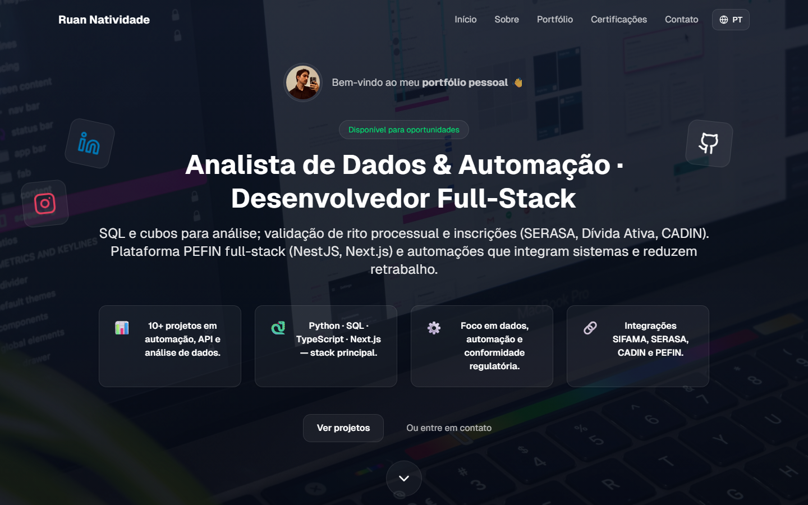

# Portfólio · Ruan Natividade

Meu site pessoal, com os projetos de dados, automação e desenvolvimento que faço na CCOBI (ANTT).

**🔗 [natiivaz.github.io](https://natiivaz.github.io)**



## O que tem no site

- **Projetos** em cards, cada um com modal de detalhes: problema, solução, stack, trecho de código e link para o repositório
- **Tecnologias, experiência e certificações**
- **Três idiomas:** português, inglês e espanhol
- **Contato** direto por e-mail, LinkedIn e GitHub

## Stack

| | |
|---|---|
| Framework | Next.js 14 com export estático (`output: "export"`) |
| Interface | React · TypeScript · Tailwind CSS · shadcn/ui (Radix) · Lucide |
| Hospedagem | GitHub Pages, com deploy por GitHub Actions |

## Rodar localmente

Requisito: Node.js 20+.

```bash
npm install
npm run dev
```

Abra **http://localhost:3002**.

## Onde editar o conteúdo

| Arquivo | O que muda |
|---|---|
| `data/site-content.ts` | Nome, textos, redes sociais, experiências (nos três idiomas) |
| `data/projects.json` | Projetos exibidos no portfólio |
| `public/images/` | Foto de perfil, fundo e imagens dos projetos |

## Deploy

Todo push na `main` dispara o workflow [`deploy.yml`](.github/workflows/deploy.yml): ele roda `npm run build`, gera o site estático em `out/` e publica no GitHub Pages.

O endereço antigo (`/Portifolio-/`) redireciona para a raiz, para não quebrar links que já circulam.
